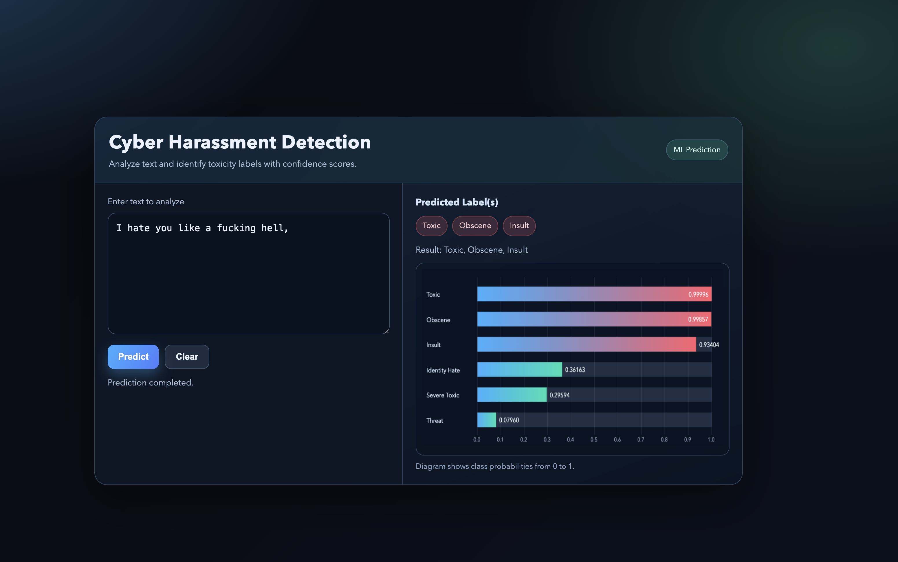
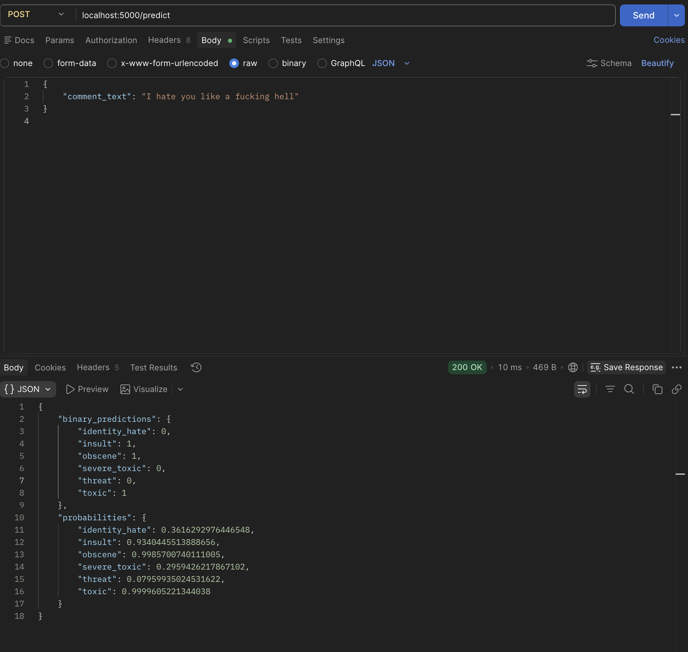

# CYBER Harassment Detection System

Detect Cyber Harassment using Machine Learning.

## Setup

- Create virtual Environment

```bash
python3 -m venv venv
source venv/bin/activate
```

```bash
pip install -e ".[dev]"
```

- Download the ML model from [Jigsaw-toxic-comment-detect.ipynb](https://colab.research.google.com/drive/189c7Usydk27ofdg0Zicg35A5iWbF8xK3?usp=sharing) and paste inside models folder.

- Run the application

```bash
flask run
```

## Web App

Web app will start where user can input the text. The prediction label will be shown to the user after prediction.

- Frontend:
  

- Backend:
  

---

### Test

We can test the prediction using `curl` command :

```bash
 curl -X POST http://localhost:5000/predict -H "Content-Type: application/json" \
     -d '{"comment_text": "I hate you as a person."}'

```

This can be done via postman **POST** request call on `http://localhost:5000/predict` with payload:

```json
{
  "comment_text": "I hate you as a person."
}
```
